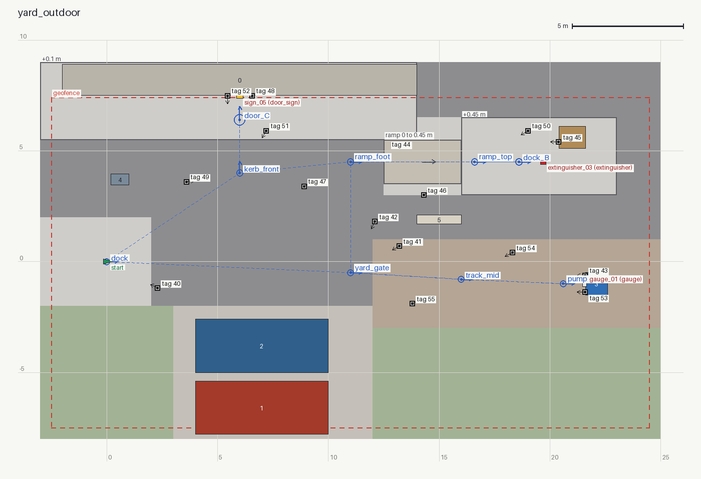

# Tutorial: from a scene to a patrol

This tutorial walks through a first program for a robot, the way someone new to spingi would write it:
1. read the scene of a place;
2. write a plan for the robot;
3. run it with the runner, from a fake robot up to a simulated one with realistic sensors;
4. replay it in the viewer;
5. measure how reliable it is.

The example is the outdoor yard that ships with the runtime, [runtime/sim/scenes/yard_outdoor.yaml](../runtime/sim/scenes/yard_outdoor.yaml), and the robot is the Unitree Go2. No robot and no GPU are needed. Every command and every output below was run on that scene; your times may differ, but the outcomes should match (the same seed gives the same run).

## 0. How the pieces fit

| Piece | What it is | Where |
|-------|------------|-------|
| **Scene** | The map: ground, walls, furniture, the objects to look for, the named places, the safety limits | a YAML file, here `sim/scenes/yard_outdoor.yaml` |
| **Plan** | What the robot must do: a list of steps, with no branches and no loops | a YAML file you write |
| **Skill** | The actions a step can ask for: `navigate`, `inspect`, `say`, ... | in the runtime |
| **Runner** | `spingi run`: checks the plan, runs it step by step, enforces the safety limits, asks the operator when a step cannot go on | the command line |
| **Adapter** | The body the plan runs on: `fake` (instant), `sim` (MuJoCo), later the real robot | `--adapter` |
| **Episode** | The record of one run: events, trajectory, frames, video | `runtime/runs/<id>/` |

```
  scene.yaml (where)          plan.yaml (what)
             \                  /
              spingi run --robot go2 --adapter fake | sim [--physics] [--realistic]
                         |
               runs/<id>/   the episode: events, trajectory, frames, video
                /                    \
     the viewer (replay it)     spingi bench (measure it)
```

The loop is always the same: **write, try on the fake adapter, try in the simulator, replay in the viewer, measure with bench**. The plan does not change from one adapter to the next; only the body it runs on does.

## 1. Set up

You need Python 3.11+ with [uv](https://docs.astral.sh/uv/); Node 20+ only if you want to run the viewer locally. Every `spingi` command runs from the `runtime` folder.

```bash
git clone https://github.com/ceccode/spingi.git
```

```bash
cd spingi/runtime && make setup
```

```bash
uv run spingi robots
```

```
g1   unitree_g1   humanoid   arm, camera, locomotion
go2  unitree_go2  quadruped  camera, locomotion
```

```bash
uv run spingi skills --robot go2
```

The Go2 has no arm: its skills are `say`, `navigate`, `inspect`, `detect` and `wait_for_human`.

## 2. Read the scene

A scene describes the world once; every plan for that place uses it. Open `sim/scenes/yard_outdoor.yaml` next to this page, and draw it:

```bash
uv run spingi map sim/scenes/yard_outdoor.yaml
```



`yard_outdoor-map.png` is the scene from above: `x` to the right, `y` up, every location with an arrow for the way the robot faces there.

### Coordinates

- Distances are in **meters** on the ground plane, `x` and `y`. The yard's dock is at the origin; the pump station is 20 m along `x`.
- Directions (`yaw`, `facing`) are in **radians**, counter-clockwise from `+x`:

| yaw | the robot faces |
|-----|-----------------|
| `0` | +x |
| `1.5708` (pi/2) | +y |
| `3.1416` (pi) | -x |
| `-1.5708` | -y |

### The sections

**`robot`**: where the robot starts.

```yaml
robot:
  pose: { x: 0.0, y: 0.0, yaw: 0.0 }
  battery_pct: 100
```

**`terrain`**: the ground, outdoors. A base surface, then rectangles of other surfaces (the last one listed wins where two overlap), ramps and raised areas such as kerbs and loading docks.

```yaml
terrain:
  extent: { x_min: -3, x_max: 25, y_min: -8, y_max: 9 }   # must cover the geofence
  cell_m: 0.1
  seed: 11                     # same seed, same bumps on every run
  surface: asphalt
  regions:
    - { surface: gravel, x: [3, 12], y: [-8, -2] }       # car park
    - { surface: dirt, x: [12, 25], y: [-3, 1] }         # track to the pump station
  ramps:
    - { x: [12.5, 16.0], y: [3.5, 5.5], from_m: 0.0, to_m: 0.45, along: x }   # about 7 degrees
  raised:
    - { x: [-3, 14], y: [5.5, 9], height_m: 0.10 }      # the kerb
```

- **Surfaces:** `floor`, `concrete`, `asphalt`, `gravel`, `dirt` and `grass`. Each has its own grip and roughness, which the robot feels under its feet with `--physics`.
- **Not supported:** pits and ditches, so neither water nor a pool's depth.

**`locations`**: the named places, the only places a plan can send the robot to.

```yaml
locations:
  dock:      { pose: { x: 0.0, y: 0.0, yaw: 0.0 } }
  yard_gate: { pose: { x: 11.0, y: -0.5, yaw: 0.0 } }   # a waypoint
  pump_A:    { pose: { x: 20.6, y: -1.0, yaw: 0.0 } }   # facing the pump cabinet
```

The `yaw` matters where the robot stops to look: at `pump_A` the camera must face the cabinet. `tolerance_m` (0.15 m by default) is how close counts as arrived.

**`obstacles`**: solid boxes standing on the ground: buildings, containers, cabinets. The robot collides with them.

```yaml
obstacles:
  - { x: 7.0, y: -3.8, w: 6.0, d: 2.4, h: 2.6, color: "#2f5f8a" }    # container
```

`x` and `y` are the box's center, `w` its size along x, `d` along y, `h` its height. Boxes are aligned with the axes and stand on the ground: no rotation, nothing that hangs in the air.

**`objects`**: what the robot looks for with its camera. They have no collision.

```yaml
objects:
  gauge_01: { cls: gauge, marker_id: 21, size: [0.06, 0.24, 0.24], pose: { x: 21.57, y: -1.0, z: 0.55 }, color: "#e8e8e8" }
```

- **`cls`:** the class that plans look for (`present:gauge`).
- **`pose`:** the object's center.
- **`marker_id`:** prints an AprilTag on the object, which is how the robot recognizes it with `--realistic`.
- **What the camera sees:** in simulation the robot sees an object up to **3 m** away and within **40 degrees** either side of where it faces. The Go2's camera is about 30 cm above the ground, so what it inspects should be low, under half a meter.

**`landmarks`**: AprilTags at known places, on posts or flat on walls (`post: false`). With `--realistic` the robot's idea of where it is drifts as it walks; reading a landmark corrects it (section 8).

**`safety`**: limits the runner enforces whatever the plan says.

```yaml
safety:
  geofence: { x_min: -2.5, x_max: 24.5, y_min: -7.5, y_max: 7.4 }   # leaving it is an emergency stop
  max_speed: 1.0                                                      # m/s: faster requests are capped
  min_battery_pct: 5
```

**`routes`**: for each leg, the waypoints that keep the robot clear of walls and obstacles. They remind plan authors of the way, and the natural language planner (`spingi plan`) follows them.

### Draw the routes before the places

The robot walks from one point to the next **in a straight line**; there is no path planner. For every leg of a route, picture the line between its two points:
- if the line crosses a wall, a container or the edge of a loading dock, add a waypoint;
- keep 0.7 to 1 m of free space on either side, because a walking robot never walks perfectly straight.

## 3. Write your first plan

Create `runtime/plans/pump_check.yaml`:

```yaml
id: pump_check                       # letters, digits, _ and -, up to 64 characters
description: "Check the pump gauge and come back to the dock"
steps:
  - skill: say
    params: { text: "Checking the pump" }
  - skill: navigate
    params: { to: pump_A, via: [yard_gate, track_mid], max_speed: 0.8 }
    on_failure: { retry: 1, then: needs_human }
  - skill: inspect
    params: { target: pump_A, checks: ["present:gauge"] }
  - skill: navigate
    params: { to: dock, via: [track_mid, yard_gate], max_speed: 0.8 }
```

### What a plan can say

```yaml
id: ...                    # required
description: "..."         # optional, shown in the viewer
deadline_s: 420            # optional: time budget for the whole run, in seconds of robot time
steps:                     # at least one
  - skill: navigate
    params: { ... }
    deadline_s: 120        # optional: time limit for this step
    on_failure: { retry: 1, then: needs_human }   # optional
```

| Skill | Parameters | What it does |
|-------|------------|--------------|
| `say` | `text` (up to 200 characters) | Says something to people; it becomes an event in the episode. |
| `navigate` | `to`, `via` (optional list), `max_speed` (m/s, default 0.5, up to 2) | Walks to `to` through the `via` places in order, in straight lines. At a waypoint it turns towards the next one; at the end it turns to the destination's `yaw`. |
| `inspect` | `target`, `checks` | Takes a frame with the head camera and evaluates the checks. The robot must already be at `target`. |
| `detect` | `cls`, `expect` (default 1) | Looks for objects of a class in front of the robot; fails if it finds fewer than `expect`. |
| `wait_for_human` | `prompt`, `timeout_s` (default 300) | Stops and asks the operator to do something before going on. |

**Checks** are `present:<cls>` (at least one is there), `absent:<cls>` (none is there) or free text, which is recorded but not evaluated yet. A check that does not pass is an **anomaly**, not a failure: the inspection succeeds, the anomaly goes into the episode, and the patrol goes on. That is what a patrol is for: the robot reports, it does not stop.

**`on_failure`** decides what happens when a step cannot reach its goal (a wall in the way, the robot not where an inspection needs it):

| | |
|---|---|
| `retry: N` | tries the step again up to N times (0 to 10). A retried `navigate` resumes from the last waypoint it reached. |
| `then: needs_human` | the default: asks the operator (section 5) |
| `then: skip` | skips the step and goes on |
| `then: abort` | stops the run |

A plan has no branches and no loops, on purpose: it can be read and checked before it runs, and it does the same thing every time ([ADR-0004](../adr/0004-plans-and-scenes-as-yaml.md)).

## 4. Run it

Run it at three levels of realism, from the fastest to the most faithful.

**The fake adapter** checks the logic of the plan in a fraction of a second. The robot moves along the path at a nominal speed; it does not model walls or the ground. Its camera sees what the simulator's would from the same place: objects within 3 m and 40 degrees either side of where the robot faces ([ADR-0024](../adr/0024-the-fake-camera-sees-what-the-sim-camera-sees.md)).

```bash
uv run spingi run plans/pump_check.yaml --scene sim/scenes/yard_outdoor.yaml --robot go2 --operator console
```

```
[    0.0s]    speed cap 1.0 m/s
[    0.0s] run r-20261122-213458-f56e79 · plan pump_check · 4 steps
[    0.0s] step 0  say {"text": "Checking the pump"}
[    0.0s]    says "Checking the pump"
[    0.0s] step 1  navigate {"to": "pump_A", "via": ["yard_gate", "track_mid"], "max_speed": 0.8}
[   25.8s] step 2  inspect {"target": "pump_A", "checks": ["present:gauge"]}
[   25.8s]    inspection at pump_A: all checks passed
[   25.8s] step 3  navigate {"to": "dock", "via": ["track_mid", "yard_gate"], "max_speed": 0.8}
[   51.6s] run end: success · 4 steps completed

SUCCESS · 4/4 steps · 51.6 s simulated · episode: runs/r-20261122-213458-f56e79
```

**How to read the output:**
- The time in brackets is **robot time**, not the time you waited.
- Each `step N` is a step of your plan. The indented lines say what happened: what the robot said, the inspections' results, retries, safety interventions.
- The last line gives the outcome, the steps completed, the duration and where the episode is.

**The simulator** (`--adapter sim`, about 3 s). Walls and obstacles are real: a route through them stops the robot. The robot still glides over the ground without walking.

```bash
uv run spingi run plans/pump_check.yaml --scene sim/scenes/yard_outdoor.yaml --robot go2 --adapter sim --operator console
```

**The simulator with physics** (`--physics`, about 4 s). The Go2 walks with the learned controller the real robot would use. It feels the gravel and the dirt and can get stuck or fall. The same run now takes 83.9 s of robot time instead of 51.6. Add `--camera-video` to record what the head camera sees and `--zip` to get a file for the viewer:

```bash
uv run spingi run plans/pump_check.yaml --scene sim/scenes/yard_outdoor.yaml --robot go2 --adapter sim --physics --camera-video --zip --operator console
```

A fourth level, `--realistic`, adds the errors of real sensors: section 8.

### Options of `spingi run`

| Option | What it is for |
|--------|----------------|
| `--scene FILE` | the scene (the default is an indoor lab: always pass it) |
| `--robot go2` | which robot (the default is the G1) |
| `--adapter fake` / `sim` | fake or simulator (default: fake) |
| `--physics` | the robot really walks (sim only) |
| `--realistic` | everything that brings the simulator closer to the real robot: physics, drifting odometry, camera noise, objects and landmarks recognized from their tags |
| `--operator console` | asks you on the terminal when a decision is needed, and prints a readable summary. Without it (`auto`) the runner decides by itself and prints the raw events as JSON. |
| `--on-failure abort` / `skip` / `retry` | the automatic answer with `--operator auto` |
| `--camera-video` | records the head camera to `head.mp4`, which the viewer plays; runs get 3 to 5 times slower |
| `--zip` | writes `runs/<id>.zip`, the file you open in the viewer |
| `--record` | records a third-person video, `run.mp4` (not shown by the viewer) |
| `--view` | opens MuJoCo's 3D window while the robot moves; on macOS use `uv run mjpython -m spingi.cli run ... --view` |
| `--realtime` | simulates in real time instead of as fast as possible |
| `--quiet` | prints the final line only |
| `--seed N` | another random sequence (noise, drift): the same seed gives the same run |
| `--noise 0.1` / `--sigma 0.05` | perception noise: 10% of objects missed, positions off by up to 5 cm |

### Outcomes

| Outcome | Meaning |
|---------|---------|
| `SUCCESS` | every step completed, anomalies included |
| `INVALID_PLAN` | the plan was refused before anything moved |
| `ABORTED` | stopped by `then: abort`, by the operator or with Ctrl+C |
| `DEADLINE` | the plan's `deadline_s` ran out |
| `ESTOP` | emergency stop: geofence left, battery under the minimum |
| `ERROR` | an error inside the runtime |

The command exits with status 0 on `SUCCESS` only, so scripts can rely on it.

## 5. When it goes wrong

### A mistake in the plan

Here is `pump_check` with three typos: a parameter, a skill and, in the last step, a place.

```yaml
  - skill: navigate
    params: { to: pump_A, via: [yard_gate, track_mid], max_sped: 0.8 }
  - skill: inspekt
    params: { target: pump_A, checks: ["present:gauge"] }
  - skill: navigate
    params: { to: dok, via: [track_mid, yard_gate], max_speed: 0.8 }
```

```
[    0.0s] plan invalid, nothing moved: step 1 (navigate): invalid parameters: max_sped: Extra inputs are not permitted; step 2: unknown skill 'inspekt'; step 3 (navigate): unknown location 'dok', did you mean 'dock'?
[    0.0s] run end: invalid_plan · 0 steps completed

INVALID_PLAN · 0/4 steps · 0.0 s simulated
```

The runner checks the whole plan before the robot moves, and reports every error at once:
- the skills exist;
- the parameters have the right names and types: a misspelled one is an error, never a setting silently ignored ([ADR-0026](../adr/0026-unknown-keys-in-plans-are-errors.md));
- the robot can run every skill (a `pick` on the Go2, which has no arm, is refused);
- every place the plan names is in the scene (`to`, `via`, `target`, `at`), with the closest name the scene has when one is close ([ADR-0025](../adr/0025-plans-name-only-locations-of-the-scene.md)). A typo in the last step of a long patrol stops the run before the first step, not when the robot gets there.

A misspelled key of the plan itself, such as `on_failre:`, is refused when the file is read, before a robot is started:

```
INVALID_PLAN · invalid plan (plans/pump_check.yaml): steps.1.on_failre: Extra inputs are not permitted
```

### A mistake in the scene

A scene is checked the same way ([ADR-0028](../adr/0028-scenes-are-checked-like-plans.md)). Write `obstacle:` for `obstacles:` in a copy of the yard, and nothing runs:

```
INVALID_SCENE · invalid scene (my_yard.yaml): obstacle: Extra inputs are not permitted
```

Without this check the containers would not be in the world, and the robot would walk through where they stand. The same holds for a misspelled limit: `max_sped:` in `safety:` is an error, not a run without its speed cap.

A scene can be a valid file and still a bad place to work. `spingi check` looks at its geometry before any run, and with `--plan` at what that plan would meet in it:

```bash
uv run spingi check my_yard.yaml --plan plans/pump_check.yaml --robot go2
```

It warns about a place outside the geofence, a place inside a box, a leg that crosses one, an object hidden inside one, an object no stop has in view, an inspection that looks the wrong way. A warning does not stop a run: the next two mistakes are ones it would have told you about.

### A route through an obstacle

This plan goes from the dock straight to `dock_B`, on the loading dock, without taking the ramp:

```yaml
  - skill: navigate
    params: { to: dock_B, max_speed: 0.8 }
    on_failure: { retry: 1, then: needs_human }
```

Without physics, the robot follows the height of the ground and floats up onto the loading dock: `SUCCESS`. With `--physics`:

```
[    0.0s] step 0  navigate {"to": "dock_B", "max_speed": 0.8}
[   27.8s]    retry 1

  OPERATOR NEEDED · step 0 (navigate)
  postcondition: 3.22 m from dock_B, tolerance 0.15 m
  [r]etry  [s]kip  [a]bort >
```

The Go2 walked into the side of the loading dock, 45 cm high, and got stuck. It tried once more and now asks you:
- `r` tries again;
- `s` skips the step;
- `a` stops the run.

The fix is in the plan: `via: [yard_gate, ramp_foot, ramp_top]`. This is why a plan is always tried with physics too: the fake adapter and a gliding robot do not see what stops a walking one.

### Inspecting from the wrong place

An `inspect` run when the robot is not at its `target` fails with `precondition: 3.20 m from pump_A, tolerance 0.15 m`. Usually the `navigate` before it is missing, or it went somewhere else.

### Stopping the robot

**Ctrl+C** in the terminal is the emergency stop: the robot stops at once, and the episode records `OPERATOR STOP`.

## 6. The episode

Every run writes a folder `runs/<id>/` ([format](episode-format.md)):

| File | Content |
|------|---------|
| `events.jsonl` | everything that happened, one event per line: steps, skills, inspections, safety, operator. The source of truth. |
| `trajectory.jsonl` | the robot's pose over time (and its joints, with `--physics`) |
| `plan.yaml`, `scene.yaml` | exact copies of the plan and scene used |
| `manifest.json` | the summary: robot, adapter, settings, outcome |
| `frames/` | the frames the robot decided on: one per inspection, three per landmark stop |
| `terrain.json` | the ground, for the viewer |
| `head.mp4` | the head camera, with `--camera-video` |

To run a recorded episode again and check that the runtime still behaves the same:

```bash
uv run spingi replay runs/r-20261122-213458-f56e79
```

```
same      runs/r-20261122-213458-f56e79  (recorded success, replayed success)
```

`same` means the same steps, outcomes and final position. `DIFFERENT` lists what changed.

## 7. The viewer

1. Open **[spingi-viewer.netlify.app](https://spingi-viewer.netlify.app)**. The file is read by your browser and is not uploaded anywhere. You can also run the viewer locally: `npm --prefix viewer install && npm --prefix viewer run dev`, then http://localhost:5173.
2. Press **Load .zip**, or drop the file on the page, and pick `runtime/runs/<id>.zip`.
3. Press play, or the space bar.

| Area | What it shows |
|------|---------------|
| 3D view | the yard, the robot walking, the places as labelled discs, the objects. Drag to orbit, scroll to zoom. |
| Top left | time, position, heading and state of the robot at that instant |
| **Robot's view**, bottom right | the head camera's video, in step with the replay. A click enlarges it. |
| **Episode** | outcome, robot, duration, plan |
| **Events** | every event; a click jumps to that instant |
| **Frames analysed** | the inspection frames; a click jumps to when each was taken |
| Bottom bar | play and pause, the timeline, the speed (0.5x to 4x), "follow robot" |

Keys: space plays and pauses, the arrows move one second. With `--realistic`, an **orange outline** shows where the robot believed it was, tied to where it really was by a dashed line. The **Sample episodes** menu has ready-made episodes, among them the Go2's full yard patrol with realistic sensors.

## 8. Realistic sensors and landmarks

A real robot does not know exactly where it is. It counts its steps (odometry), and the count drifts: a degree of heading error turns into half a meter after thirty meters. With `--realistic` the simulator does the same:
- the odometry drifts;
- the camera frames are noisy and compressed;
- objects and landmarks are recognized only from their AprilTags in the frames, as a real camera would.

Run the full yard patrol, [plans/yard_patrol.yaml](../runtime/plans/yard_patrol.yaml), on a copy of the yard **without its landmarks**:

```
[   39.8s]    inspection at pump_A: anomalies present:gauge
[   97.0s]    inspection at dock_B: anomalies present:extinguisher
[  138.6s]    inspection at door_C: anomalies present:door_sign

SUCCESS · 9/9 steps · 166.0 s simulated
```

The outcome says `SUCCESS`, and all three inspections are wrong:
- The robot ended up 2 m from where it believed it was by the pump, and 2.7 m by the end.
- At each stop it looked at the wrong spot, and it reported missing objects that were there.

A run that completes is not a run that worked: read the anomalies, and in the viewer watch the orange outline drift away from the robot.

With the yard's 16 landmarks, the same command:

```bash
uv run spingi run plans/yard_patrol.yaml --scene sim/scenes/yard_outdoor.yaml --robot go2 --realistic --operator console
```

```
[   43.6s]    inspection at pump_A: all checks passed
[  109.3s]    inspection at dock_B: all checks passed
[  153.6s]    inspection at door_C: all checks passed

SUCCESS · 9/9 steps · 183.9 s simulated
```

The robot read a tag 24 times and was never more than 0.3 m from where it believed it was ([ADR-0016](../adr/0016-drifting-odometry-landmarks-and-camera-noise.md)).

### Where to put landmarks

Before it leaves and at every place it reaches, the robot looks for the tags that should be in front of it: within ten times the tag's side (3 m for a 30 cm tag) and 45 degrees either side of where it faces. If it reads one, it corrects its estimate and walks the difference. Rules of thumb:

- a tag 2 to 3 m ahead of every stop and every waypoint, in the direction the robot faces when it leaves for the next point;
- about 70 cm to the side of the route, so the robot does not walk into its post;
- `facing` pointing back towards where the robot reads it;
- at an inspection stop close to a wall, small tags (16 cm) flat on the wall on either side of what it inspects, like the pump cabinet's.

```yaml
landmarks:
  - { marker_id: 41, x: 13.2, y: 0.7, facing: -2.642, size_m: 0.3 }      # yard gate, towards the pump
  - { marker_id: 43, x: 21.59, y: -0.62, facing: 3.1416, height_m: 0.45, size_m: 0.16, post: false }  # pump cabinet
```

A marker id names one tag: objects and landmarks cannot share one.

## 9. Measure it: `spingi bench`

One successful run says little. `bench` runs the plan many times, with a different random sequence each time, and checks a gate: how reliable a plan must be before it moves from the simulator to the robot.

```bash
uv run spingi bench plans/yard_patrol.yaml --scene sim/scenes/yard_outdoor.yaml --robot go2 --realistic --runs 20
```

```
plan yard_patrol · scene sim/scenes/yard_outdoor.yaml · unitree_go2 on sim (physics, odometry drift, camera noise, markers) · 20 runs
perception noise: false negatives 0%, position sigma 0.0 m

  ok    success rate        100.0%   (gate >= 95%)
  ok    operator requests   0.0 per 100 runs   (gate <= 5)
  ok    fatal runs          0   (gate <= 0)
  ok    safety violations   0   (gate <= 0)
        retries per run     0.00
  ok    simulated time       p50 197.4 s · p95 226.6 s   (gate <= 420 s, the plan's deadline_s)
        pose error           worst of each run p50 0.40 m · p95 0.73 m   (where it was against where it believed it was)
        landmark fixes       25.6 per run · 0.1 expected and not seen

GATE PASSED
```

Twenty runs with realistic sensors take a few minutes on a laptop.

- **success rate:** runs that ended with `SUCCESS`.
- **operator requests:** how often the robot would have called someone, per 100 runs.
- **safety violations:** must be zero.
- **simulated time:** the typical (p50) and the slowest (p95) runs, against the plan's `deadline_s`.
- **pose error:** the worst distance between where the robot was and where it believed it was, in each run.
- **landmark fixes:** tags read, and tags it expected and could not see.
- **anomalies reported:** what the inspections found, when they found anything. Twenty patrols of a yard where everything is in place report none.

`--noise 0.1` adds perception misses on top, and `--gate` makes the command exit with status 1 when the gate fails, for scripts and CI. The gate's thresholds are in [runtime/README.md](../runtime/README.md#benchmarks-and-the-sim-to-real-gate).

## 10. Model your own place

The yard was written by hand, and so can yours be. A floor plan is the best source.

1. **Scale.** On a 1:100 plan, measure a known dimension (a facade, a door) in pixels, and you have the pixels per meter. Choose an origin, such as a building's corner, and measure everything from it, `x` to the right and `y` up.
2. **Buildings and furniture** become boxes:
   - center, width along x, depth along y, height;
   - heights from the elevation or from photos;
   - an L-shaped building is two or three boxes;
   - a slanted fence is a row of short boxes.
3. **The ground** is a base surface and rectangles: lawn, paving, gravel. Kerbs and steps are `raised`, slopes are `ramps`.
4. **What cannot be modeled yet:** water and pits (a pool is a flat blue box: keep routes at least a meter from it, the robot would not fall in), overhangs and porch roofs, rotated walls.
5. **The places:** an inspection stop 1 to 3 m from what it checks and facing it, waypoints wherever a straight line would hit something, then a landmark ahead of each.
6. **Check it and look at it:** `spingi check my_place.yaml` for what the file gets wrong and what a robot would meet, `spingi map my_place.yaml` to compare the picture with your floor plan.
7. **Then the same loop:** fake, sim, physics, realistic, bench.

A model of a home is personal data. Keep it, and the episodes made in it (they contain the scene), out of public repositories.

## 11. Exercises

Copy the scene or the plan before you change them, and pass the copy to `--scene`.

1. **A missing extinguisher.** Remove `extinguisher_03` from a copy of the yard and run the yard patrol with `--physics`: at `dock_B` the inspection reports `anomalies present:extinguisher`, and the patrol goes on.
2. **One more stop.** Extend `pump_check` to check the sign at door C on the way back:
   ```yaml
     - skill: navigate
       params: { to: door_C, via: [track_mid, yard_gate, kerb_front], max_speed: 0.6 }
       on_failure: { retry: 1, then: needs_human }
     - skill: inspect
       params: { target: door_C, checks: ["present:door_sign"] }
     - skill: navigate
       params: { to: dock, via: [kerb_front], max_speed: 0.8 }
   ```
   It passes with `--physics` and with `--realistic`. The robot steps up the 10 cm kerb head on at `kerb_front`.
3. **The shortcut.** Run the `dock_B` shortcut of section 5 with and without `--physics`, and answer the operator.
4. **Lost without landmarks.** Remove the `landmarks:` section from a copy of the yard and run the patrol with `--realistic`. Open both episodes in the viewer and compare the orange outlines.
5. **The speed cap.** Ask for `max_speed: 1.8` in a step. The `speed cap 1.0 m/s` line at the start of every run is the scene's `max_speed`, set on the robot before the first step: no plan can make it go faster. Then lower the scene's `max_speed` to 0.5 and watch the patrol take longer.

## 12. Where next

- **Plans from plain language:**
  ```bash
  uv run spingi plan "check the pump gauge and come back" --scene sim/scenes/yard_outdoor.yaml --robot go2 --out plans/from_text.yaml
  ```
  This writes a plan from a sentence with Claude. It needs the `llm` extra and an API key in `runtime/.env`, and each request is billed. Read and run the result like any other plan: the model proposes, the runtime checks and decides ([ADR-0003](../adr/0003-llm-proposes-runtime-disposes.md)).
- **With a coding agent:** `spingi mcp` gives an agent in Claude Code, Codex or OpenCode the tools to do what this tutorial does, with you: write the scene of your place, check it, draw it, plan, run, measure. See [agents.md](agents.md).
- **From Python:** everything in this tutorial is a function of `spingi.api`: `api.check_plan(...)`, `api.run(..., mode="physics")`, `api.bench(...)`. See [runtime/README.md](../runtime/README.md#python-api).
- **Datasets:** `spingi export lerobot runs/<id> --out <dir>` turns episodes into a LeRobot dataset.
- **Extending:** writing a skill or an adapter is in [runtime/README.md](../runtime/README.md#extending); the principles and contracts are in [runtime-spec.md](runtime-spec.md).
